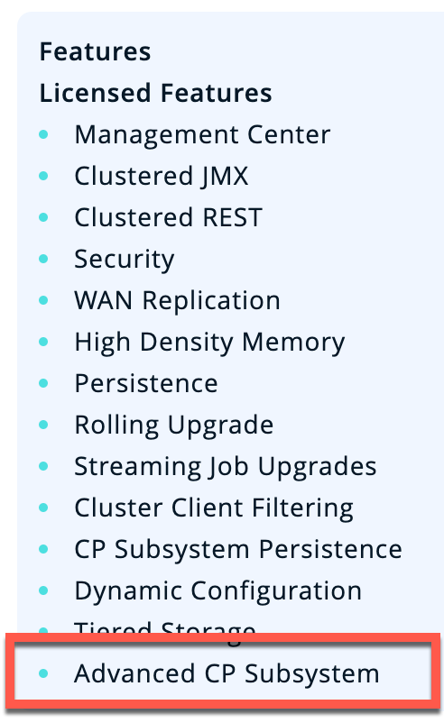
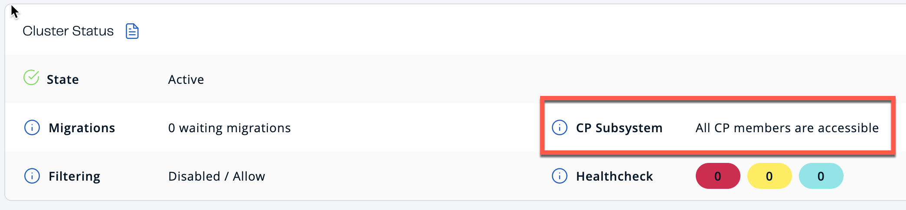
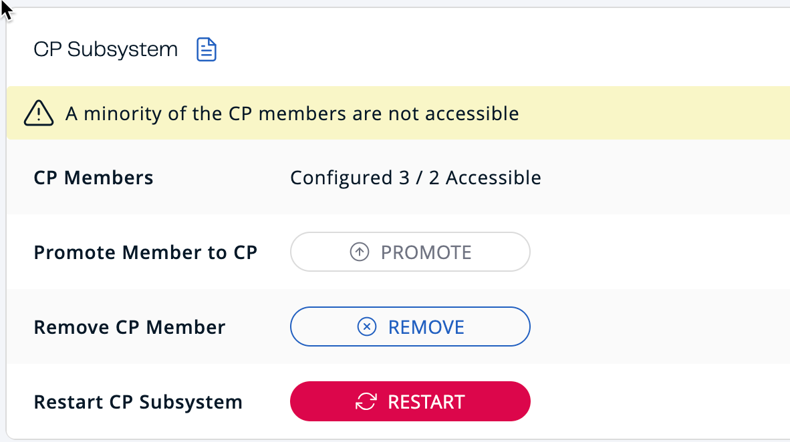
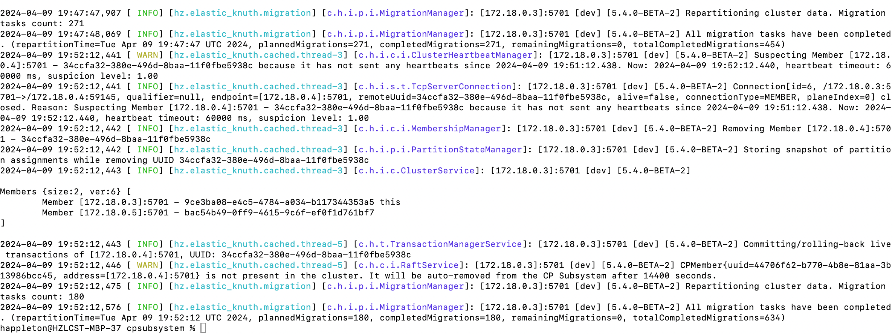
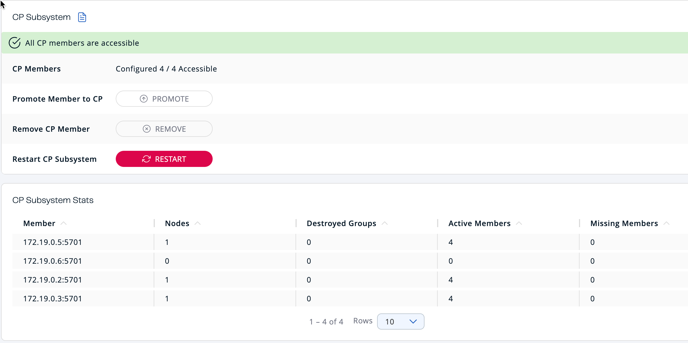
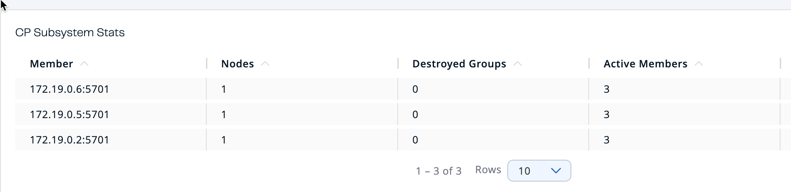

In this tutorial, you will examine the operations of a CP-enabled Hazelcast Platform cluster, then work with the `CPMap` data structure using the Hazelcast CLC.

## Context

The Hazelcast CP Subsystem adds the capability of true consistency to the primarily AP Hazelcast Platform. When the CP Subsystem is enabled, application developers have access to `CPMap`, a key-value store similar in function to `IMap` that provides consistency guarantees. The CP Subsystem also supports Java concurrency primitives, guaranteeing atomic operations of these data structures.

## Before you Begin

Before starting this tutorial, make sure that you have installed the following:

- [Docker](https://www.docker.com/)
- [Hazelcast Command Line Client (CLC)](/clc/latest/overview)
- [JDK 17 or later](https://www.oracle.com/java/technologies/downloads/)
- [Docker Desktop](https://www.docker.com/products/docker-desktop/)

Optional

- [Maven](https://maven.apache.org/)
- Your preferred Java IDE

## Step 1. Set up the Cluster and Verify Operations

In this section, you'll launch a Hazelcast cluster and Management Center using Docker. You'll verify that the CP Subsystem is up and ready for data. You'll then pause, then restart a cluster member and observe the changes in Management Center and view the system logs.

1. Download the repository from [GitHub](https://github.com/hazelcast-guides/cpsubsystem).
2. Run the following commands to start a Hazelcast cluster

   ```cli
   docker compose up -d
   docker compose ps
   ```

   You should see four services up and running: three instances of Hazelcast, and one instance of Management Center.

3. Open the file `hazelcast.yaml` to review the cluster member configuration.
4. Open a web browser and connect to **`localhost:8080`**. This will open Management Center. Select Dev Mode to open the main dashboard. Go to **Settings**, then open **License**. Paste in the license key from `hazelcast.yaml`. Verify that the license includes Advanced CP, which is required for `CPMap` functionality.

   

5. Close the settings screen. The main dashboard should show that the CP Subsystem is accessible.

   

6. Scroll down to verify that the cluster has a total of three nodes.
7. From the left side menu, go to **CP Subsystem \> Dashboard**. Note that the CP Subsystem has three nodes in the CP Stats window. Under CP Groups, the only group that exists is METADATA; this group is used for CP Subsystem management.

## Step 2. Create a `CPMap` Using CLC

In this step, you'll use the CLC to connect to one of the cluster members. You'll create a `CPMap` and add data to the map. You'll then retrieve data from the map.

1. Open a separate terminal window. Enable `CPMap` capabilities in CLC (only needed for CLC 5.3.7).

   ```cli
   export CLC_EXPERIMENTAL_CPMAP=1
   ```

2. Start CLC using the provided configuration file.

   ```cli
   clc -c clc_docker.yaml
   ```

3. At the SQL prompt, use the `cpmap` commands to create a `CPMap` and add data, then retrieve the data.

   ```cli
   \cpmap -n trektos set 1 "James Kirk"
   \cpmap -n trektos get 1
   ```

   :::note

   The backslash is needed for all CLC commands. Otherwise CLC assumes you are entering SQL commands. Type `\help` for a list of all available commands.

   :::

4. Run the `trektos.clc` script to add data to the `CPMap`.

   ```cli
   \script run trektos.clc
   ```

5. Verify that additional entries have been added to the map.

   ```cli
   \cpmap -n trektos get 6
   ```

6. In Management Center, examine the CP Subsystem dashboard. Note that there is now a "default" group. This is the group maintaining the RAFT algorithm for the `trektos` `CPMap`.
7. In Management Center, select `CPMap`s from the left side. The screen lists the `CPMap` you just created, along with map statistics.
8. (Optional) In the Client subdirectory, we've included a sample Java client that creates an additional `CPMap`. To run the client, change to the Client subdirectory, then run the following Maven commands.

   ```cli
   mvn clean compile exec:java -Dexec.mainClass="Client4CP"
   ```

   Use CLC and Management Center to verify the creation of a second `CPMap`.

## Step 3. Simulating a Network Partition

In this section, you will pause and restart individual cluster members to simulate network partition and member failure conditions. You'll learn about when the CP Subsystem can heal itself, and when administrator intervention is required.

1. From the CLC, run the script sw.clc. This creates an `IMap`. We will use this to compare data accessibility between an AP `IMap` and a CP `CPMap`.

   ```cli
   \script run sw.clc
   ```

2. Retrieve an entry from the `IMap`.

   ```cli
   \map -n starwars get 1
   ```

3. In the terminal window, stop cluster member 2. Observe the changes in the CP Subsystem dashboard.

   ```cli
   docker stop cpsubsystem-hz2-1
   ```

   

4. Review the log entries of one of the remaining members to see messages related to data migration for AP data and group rebalancing for CP data. The command is `docker logs <container>`.

   Example output:

   

5. Using CLC, verify that you can still access both `IMap` and `CPMap` data.

   ```cli
   \map -n starwars get 1
   \cpmap -n trektos get 1
   ```

6. Stop cluster member 3. Note the changes in Management Center.

   ```none
   docker stop cpsubsystem-hz3-1
   ```

7. Verify that you can still access AP data, but cannot access CP data. Accessing CP data will give you a "Connecting to cluster…​" message.
8. Start cluster member 2

   ```cli
   docker start cpsubsystem-hz2-1
   ```

   :::note

   At this point, we have created a situation where the CP Subsystem is unrecoverable. There is only a minority left in the group, and there is no majority "out there" that retains any CP data. The only path to recovery is to restart all the cluster members. The lesson here is to configure resilience into your CP Subsystem so this cannot happen!

   :::

9. Use Docker compose to remove all your containers.

   ```cli
   docker compose down
   ```

## Step 4: Configuring Resilience (Optional)

In this step, we will add another cluster member, and configure the cluster for automatic member failure.

1. Open the file `compose.yaml`. Add a fourth instance of Hazelcast to the file. Save your changes.

   ```cli
     hz4:
       image: hazelcast/hazelcast-enterprise:5.4.0
       environment:
         JAVA_OPTS: -Dhazelcast.config=/project/hazelcast.yaml
       volumes:
         - ".:/project"
   ```

2. Open the file `hazelcast.yaml`. Modify the configuration as follows:
   1. Set the member count to 4
   2. Add the timeout and set it to 60 seconds
   3. Add the auto-removal and set it to 60 seconds

      ```cli
        cp-subsystem:
          cp-member-count: 3
          group-size: 3
          session-time-to-live-seconds: 60
          missing-cp-member-auto-removal-seconds: 60
      ```

3. Start up the containers.

```cli
docker compose up -d
```

1. In Management Center, go to the CP Subsystem dashboard. You should now see four members listed. Note that one has zero nodes. This means it is not participating in any groups.

   

2. Check the IP address of hz4. If it is one of the active CP members, stop it. If it is not, then stop hz3. Observe the changes in Management System over the next few minutes.

   ```cli
   docker container inspect cpsubsystem-hz4-1 | grep "IPAddress"
   docker stop cpsubsystem-hz4-1
   ```

3. Note that the node that previously was not participating in groups has been promoted and is now partipating in the group.

   

4. Restart the stopped container. There will be no changes in Management Center, nor to the CP Subsystem. If you look at the log for the restarted system, you will see the following message.

`2024-04-16 16:25:43 2024-04-16 23:25:43,655 [ INFO] [hz.recursing_benz.generic-operation.thread-3] [c.h.c.i.MetadataRaftGroupManager]: [172.19.0.3]:5701 [dev] [5.4.0] Disabling discovery of initial CP members since it is already completed...`

1. To bring the CP Subsystem back to all four members, use the Management Center dashboard to promote the restarted member.

:::note

Because we only have one group, no group rebalancing will occur. You can verify this by looking at the system logs for each member.

:::

## What's Next?

You now have a working CP Subsystem setup. Experiment with creating multiple groups to observe group distribution when there are more subsystem members than needed by each group. Work with other CP data structures. The documentation links below will provide additional information on

## Summary

In this tutorial, you worked with the `CPMap` data structure, and experimented with CP Subsystem management.

## See Also

- [CP Subsystem Overview](/hazelcast/latest/cp-subsystem/cp-subsystem)
- [`CPMap` Documentation](/hazelcast/latest/data-structures/cpmap)
- [CP Subsystem Persistence](/hazelcast/latest/cp-subsystem/cp-subsystem#persistence)
