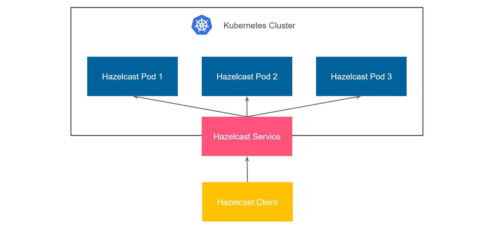
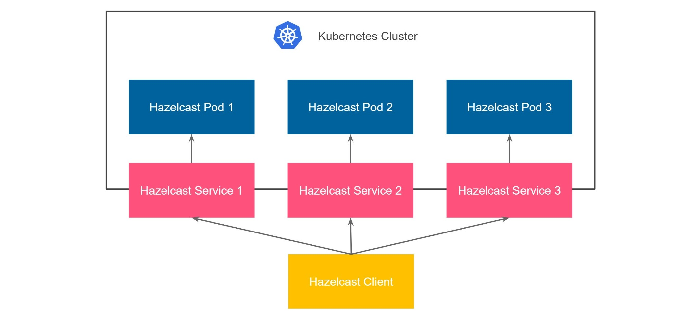

import Tabs from '@theme/Tabs';
import TabItem from '@theme/TabItem';
import CodeBlock from '@theme/CodeBlock';
import Ex_kubernetes_external_client_kubernetes_external_client_values_yaml from '@site/.tutorial-examples/kubernetes-external-client/kubernetes-external-client/values.yaml';

:::note

This guide uses Helm and Kubectl for deploying the Hazelcast cluster. If you want to use the Hazelcast Platform Operator instead, see [Connect to Hazelcast from Outside Kubernetes](/tutorials/hazelcast-platform-operator-expose-externally).

:::

## What You'll Learn

Deploy a Hazelcast Kubernetes cluster and connect to it, using a client outside Kubernetes.

## Before you Begin

- Up and running [Kubernetes](https://kubernetes.io/) cluster ([Minikube](https://minikube.sigs.k8s.io/docs/) is good enough)
- Kubernetes command line tool, [kubectl](https://kubernetes.io/docs/tasks/tools/install-kubectl/)

## Introduction

There are two approaches you may want to use when setting up on-premises Hazelcast cluster in Kubernetes:

- **Unisocket Client** - client sends requests to a random Hazelcast member
- **Smart Client** - client connects to all members and sends requests directly to the members owning the data

Let's see both approaches.

## Unisocket Client

The simplest possible scenario is to deploy the Hazelcast cluster on Kubernetes and expose all Hazelcast pods with one `LoadBalancer` (or `NodePort`) service. With that approach, we piggyback on the standard Kubernetes mechanism, which automatically load balances the traffic to Hazelcast members.



### Starting Hazelcast cluster

There are different ways of deploying Hazelcast to Kubernetes. For the production environment we recommend using Helm.

<Tabs groupId="helm--kubectl">
<TabItem value="kubectl" label="Kubectl">

```bash
kubectl apply -f https://raw.githubusercontent.com/hazelcast/hazelcast/master/kubernetes-rbac.yaml

kubectl run hz-hazelcast-0 --image=hazelcast/hazelcast -l "role=hazelcast"
kubectl run hz-hazelcast-1 --image=hazelcast/hazelcast -l "role=hazelcast"
kubectl run hz-hazelcast-2 --image=hazelcast/hazelcast -l "role=hazelcast"

kubectl create service loadbalancer hz-hazelcast --tcp=5701 -o yaml --dry-run=client | kubectl set selector --local -f - "role=hazelcast" -o yaml | kubectl create -f -
```

</TabItem>
<TabItem value="helm" label="Helm">

```bash
helm repo add hazelcast https://hazelcast-charts.s3.amazonaws.com/
helm repo update
helm install hz-hazelcast --set service.type=LoadBalancer hazelcast/hazelcast
```

</TabItem>
</Tabs>

### Verifying Hazelcast cluster

You can check that the Hazelcast cluster is up and running.

```bash
kubectl get pods
NAME             READY   STATUS    RESTARTS   AGE
hz-hazelcast-0   1/1     Running   0          32s
hz-hazelcast-1   1/1     Running   0          30s
hz-hazelcast-2   1/1     Running   0          29s
```

You can also check that all Hazelcast members formed a cluster.

```bash
kubectl logs hz-hazelcast-0
...
Members {size:3, ver:3} [
        Member [10.216.6.7]:5701 - 6d2100e0-8dcf-4e7c-ab40-8e98e23475e3 this
        Member [10.216.5.6]:5701 - 5ab4d554-fd7d-4929-8475-0ddf79a21076
        Member [10.216.8.6]:5701 - 7f7dd5f4-e732-4575-89d6-a6e823da38da
]
```

At this point you have a Hazelcast cluster exposed with a single LoadBalancer service called `hz-hazelcast`. You can find it's address with the following command.

```bash
kubectl get service hz-hazelcast
NAME           TYPE           CLUSTER-IP       EXTERNAL-IP       PORT(S)          AGE
hz-hazelcast   LoadBalancer   10.108.141.178   10.96.184.178     5701:31434/TCP   5m44s
```

:::note

If you are using Minikube, you need to execute `minikube tunnel` now in order to get LoadBalancer External IPs assigned.

:::

The field `EXTERNAL-IP` is the address of your Hazelcast cluster.

### Connecting with Hazelcast Client

To access all examples, clone the following repository

```bash
git clone https://github.com/hazelcast-guides/kubernetes-external-client.git
cd kubernetes-external-client
```

Configure the Hazelcast client with the external address and disable smart routing to use the unisocket connection.

<Tabs groupId="c--go--java--net--nodejs--python">
<TabItem value="java" label="Java">

```java
ClientConfig config = new ClientConfig();
config.getNetworkConfig().addAddress("<EXTERNAL-IP>")
                         .setSmartRouting(false);
```

</TabItem>
<TabItem value="nodejs" label="NodeJS">

```javascript
const { Client } = require('hazelcast-client');

const clientConfig = {
    network: {
        clusterMembers: [
            '<EXTERNAL-IP>'
        ],
        smartRouting: false
    }
};
const client = await Client.newHazelcastClient(clientConfig);
```

</TabItem>
<TabItem value="go" label="Go">

```go
import (
	"log"

	"github.com/hazelcast/hazelcast-go-client"
)

func main() {
	config := hazelcast.Config{}
	cc := &config.Cluster
	cc.Network.SetAddresses("<EXTERNAL-IP>")
	cc.Unisocket = true
	ctx := context.TODO()
	client, err := hazelcast.StartNewClientWithConfig(ctx, config)
	if err != nil {
		panic(err)
	}
}
```

</TabItem>
<TabItem value="python" label="Python">

```python
import logging

import hazelcast

logging.basicConfig(level=logging.INFO)

client = hazelcast.HazelcastClient(
    cluster_members=["<EXTERNAL-IP>"],
    smart_routing=False,
)
```

</TabItem>
<TabItem value="c" label="C++">

```cpp
hazelcast::client::client_config config;
config.get_network_config().add_address(hazelcast::client::address{"<EXTERNAL-IP>", 5701})
                            .set_smart_routing(false);
```

</TabItem>
<TabItem value="net" label=".NET">

```cs
    var options = new HazelcastOptionsBuilder()
        .With(args)
        .With((configuration, options) =>
        {
            // configure logging factory and add the console provider
            options.LoggerFactory.Creator = () => LoggerFactory.Create(loggingBuilder =>
                loggingBuilder
                    .AddConfiguration(configuration.GetSection("logging"))
                    .AddConsole());
            options.Networking.Addresses.Add("<EXTERNAL IP>");
            options.Networking.SmartRouting = false;
        })
        .WithDefault("Logging:LogLevel:Hazelcast", "Debug")
        .Build();
```

</TabItem>
</Tabs>

Finally, start the client application using the following command.

<Tabs groupId="c--go--java--net--nodejs--python">
<TabItem value="java" label="Java">

```bash
cd java-unisocket
mvn package
java -jar target/*jar-with-dependencies*.jar
```

</TabItem>
<TabItem value="nodejs" label="NodeJS">

```bash
cd nodejs-unisocket
npm install
npm start
```

</TabItem>
<TabItem value="go" label="Go">

```bash
cd go-unisocket
go run main.go
```

</TabItem>
<TabItem value="python" label="Python">

```bash
cd python-unisocket
pip install -r requirements.txt
python main.py
```

</TabItem>
<TabItem value="c" label="C++">

```bash
cd cpp-unisocket
cmake -B build -S . -DCMAKE_BUILD_TYPE=Release -DCMAKE_TOOLCHAIN_FILE=/path/to/vcpkg/scripts/buildsystems/vcpkg.cmake
cmake --build build --verbose
./build/cpp-unisocket
```

</TabItem>
<TabItem value="net" label=".NET">

```bash
cd dotnet-unisocket
dotnet build
dotnet run
```

</TabItem>
</Tabs>

You should see the following output.

```shell script
Successful connection!
Starting to fill the map with random entries.
Current map size: 2
Current map size: 3
Current map size: 4
Current map size: 5
Current map size: 6
Current map size: 7
Current map size: 8
Current map size: 9
Current map size: 10
```

### Clean Up

To clean up the environment execute the following commands.

<Tabs groupId="helm--kubectl">
<TabItem value="kubectl" label="Kubectl">

```bash
kubectl delete pod/hz-hazelcast-0 pod/hz-hazelcast-1 pod/hz-hazelcast-2 service/hz-hazelcast
kubectl delete -f https://raw.githubusercontent.com/hazelcast/hazelcast/master/kubernetes-rbac.yaml
```

</TabItem>
<TabItem value="helm" label="Helm">

```bash
helm uninstall hz-hazelcast
```

</TabItem>
</Tabs>

Unisocket is very simple to configure; however, it has one significant drawback - low performance. Using a load balancer is perfect for traffic distribution across stateless services; however, Hazelcast is not stateless. Actually, Hazelcast is more like a sharded database in which each member contains a different part of the data. That is why it's suboptimal to randomly load balance the traffic. It effectively means that each operation needs to be internally migrated, because your data may be load balanced to member 1, while the partition for its key is stored in member 2. All in all, if performance is important for your use case, then you need to use smart client.

## Smart Client

Hazelcast smart client is capable of mapping the given key with its owner member, which means that it sends the data directly to the member which contains the right data partition. This fact implies that in the Kubernetes environment, we need to provide access to each Hazelcast pod from the outside. A dynamic approach to this problem is to expose each pod with a separate service. Again, the service can be either `LoadBalancer` or `NodePort`. In a real-life scenario, that would probably be `NodePort`, since having a separate public IP for each pod is expensive.



Kubernetes does not offer a feature for automatically creating a service for each pod. That is why to set up a cluster this way we need to either expose each pod manually with `kubectl` or use Helm by enabling `externalAccess` feature.

:::note

If you are using Minikube, you need to execute `minikube tunnel` now in order to get LoadBalancer External IPs assigned.

:::

<Tabs groupId="helm--kubectl">
<TabItem value="kubectl" label="Kubectl">

To create a `loadbalancer` for each running Hazelcast pod you need to run the following commands:

```bash
kubectl apply -f https://raw.githubusercontent.com/hazelcast/hazelcast/master/kubernetes-rbac.yaml

kubectl create service loadbalancer hz-hazelcast-0 --tcp=5701
kubectl run hz-hazelcast-0 --image=hazelcast/hazelcast --port=5701 -l "app=hz-hazelcast-0,role=hazelcast"
kubectl create service loadbalancer hz-hazelcast-1 --tcp=5701
kubectl run hz-hazelcast-1 --image=hazelcast/hazelcast --port=5701 -l "app=hz-hazelcast-1,role=hazelcast"
kubectl create service loadbalancer hz-hazelcast-2 --tcp=5701
kubectl run hz-hazelcast-2 --image=hazelcast/hazelcast --port=5701 -l "app=hz-hazelcast-2,role=hazelcast"

kubectl create service loadbalancer hz-hazelcast --tcp=5701 -o yaml --dry-run=client | kubectl set selector --local -f - "role=hazelcast" -o yaml | kubectl create -f -
```

</TabItem>
<TabItem value="helm" label="Helm">

To start the Hazelcast cluster with external access feature enabled, you need to make the following configuration in the `values.yaml` file:

<CodeBlock language="yaml" title="values.yaml">{Ex_kubernetes_external_client_kubernetes_external_client_values_yaml}</CodeBlock>

```bash
helm repo add hazelcast https://hazelcast-charts.s3.amazonaws.com/
helm repo update
helm install hz-hazelcast -f service-per-pod/values.yaml hazelcast/hazelcast
```

</TabItem>
</Tabs>

:::note

Note that each service created per pod must start before the Hazelcast pod itself. Otherwise Hazelcast won't be able to resolve its public addresses. We are achieving this by running init containers to ensure each member's matching service has its external address.

:::

### Verifying Hazelcast cluster {/* #verifying-hazelcast-cluster-2 */}

You can check that the Hazelcast cluster is up and running.

```bash
kubectl get pods
NAME             READY   STATUS    RESTARTS   AGE
hz-hazelcast-0   1/1     Running   0          32s
hz-hazelcast-1   1/1     Running   0          30s
hz-hazelcast-2   1/1     Running   0          29s
```

At this point, you should also have every Hazelcast member exposed with a separate externally accessible address.

```bash
kubectl get service
NAME             TYPE           CLUSTER-IP       EXTERNAL-IP      PORT(S)          AGE
hz-hazelcast     LoadBalancer   10.219.246.40    35.230.84.127    5701:30443/TCP   4m2s
hz-hazelcast-0   LoadBalancer   10.219.255.141   34.145.108.167   5701:30091/TCP   4m7s
hz-hazelcast-1   LoadBalancer   10.219.241.203   34.82.71.106     5701:30687/TCP   4m5s
hz-hazelcast-2   LoadBalancer   10.219.247.106   35.247.93.190    5701:32452/TCP   4m4s
```

We'll use the `hz-hazelcast` service for the discovery.

```bash
kubectl get service hz-hazelcast
NAME           TYPE           CLUSTER-IP      EXTERNAL-IP     PORT(S)          AGE
hz-hazelcast   LoadBalancer   10.219.246.40   35.230.84.127   5701:30443/TCP   5m29s
```

The field `EXTERNAL-IP` is the address of your Hazelcast cluster.

### Connecting with Hazelcast Client {/* #connecting-with-hazelcast-client-2 */}

Configure the Hazelcast client to connect to the cluster external address.

<Tabs groupId="c--go--java--net--nodejs--python">
<TabItem value="java" label="Java">

```java
ClientConfig config = new ClientConfig();
config.getNetworkConfig().addAddress("<EXTERNAL-IP>");
config.getProperties().setProperty(ClientProperty.DISCOVERY_SPI_PUBLIC_IP_ENABLED.toString(), "true");
```

</TabItem>
<TabItem value="nodejs" label="NodeJS">

```javascript
const { Client } = require('hazelcast-client');

const clientConfig = {
    network: {
        clusterMembers: [
            '<EXTERNAL-IP>'
        ]
    },
    properties: {
        ['hazelcast.discovery.public.ip.enabled']: true
    }
};
const client = await Client.newHazelcastClient(clientConfig);
```

</TabItem>
<TabItem value="go" label="Go">

```go
import (
	"log"

	"github.com/hazelcast/hazelcast-go-client"
)

func main() {
	config := hazelcast.Config{}
	cc := &config.Cluster
	cc.Network.SetAddresses("<EXTERNAL-IP>")
	cc.Discovery.UsePublicIP = true
	ctx := context.TODO()
	client, err := hazelcast.StartNewClientWithConfig(ctx, config)
	if err != nil {
		panic(err)
	}
}
```

</TabItem>
<TabItem value="python" label="Python">

```python
import logging

import hazelcast

logging.basicConfig(level=logging.INFO)

client = hazelcast.HazelcastClient(
    cluster_members=["<EXTERNAL-IP>"],
    use_public_ip=True,
)
```

</TabItem>
<TabItem value="c" label="C++">

```cpp
    hazelcast::client::client_config config;
    config.get_network_config().use_public_address(true)
                            .add_address(hazelcast::client::address{"<EXTERNAL-IP>", 5701});
```

</TabItem>
<TabItem value="net" label=".NET">

```cs
var options = new HazelcastOptionsBuilder()
    .With(args)
    .With((configuration, options) =>
    {
        // configure logging factory and add the console provider
        options.LoggerFactory.Creator = () => LoggerFactory.Create(loggingBuilder =>
            loggingBuilder
                .AddConfiguration(configuration.GetSection("logging"))
                .AddConsole());

        options.Networking.Addresses.Add("<EXTERNAL IP>");
        options.Networking.UsePublicAddresses = true;
    })
    .WithDefault("Logging:LogLevel:Hazelcast", "Debug")
    .Build();
```

</TabItem>
</Tabs>

Finally, start the client application using the following command.

<Tabs groupId="c--go--java--net--nodejs--python">
<TabItem value="java" label="Java">

```bash
cd java
mvn package
java -jar target/*jar-with-dependencies*.jar
```

</TabItem>
<TabItem value="nodejs" label="NodeJS">

```bash
cd nodejs
npm install
npm start
```

</TabItem>
<TabItem value="go" label="Go">

```bash
cd go
go run main.go
```

</TabItem>
<TabItem value="python" label="Python">

```bash
cd python
pip install -r requirements.txt
python main.py
```

</TabItem>
<TabItem value="c" label="C++">

```bash
cd cpp
cmake -B build -S . -DCMAKE_BUILD_TYPE=Release -DCMAKE_TOOLCHAIN_FILE=/path/to/vcpkg/scripts/buildsystems/vcpkg.cmake
cmake --build build --verbose
./build/cpp
```

</TabItem>
<TabItem value="net" label=".NET">

```cs
cd dotnet
dotnet build
dotnet run
```

</TabItem>
</Tabs>

You should see the following output.

```shell script
Successful connection!
Starting to fill the map with random entries.
Current map size: 2
Current map size: 3
Current map size: 4
Current map size: 5
Current map size: 6
Current map size: 7
Current map size: 8
Current map size: 9
Current map size: 10
```

### Clean Up {/* #clean-up-2 */}

To clean up the environment execute the following commands.

<Tabs groupId="helm--kubectl">
<TabItem value="kubectl" label="Kubectl">

```bash
kubectl delete pod/hz-hazelcast-0 service/hz-hazelcast-0 pod/hz-hazelcast-1 service/hz-hazelcast-1 pod/hz-hazelcast-2 service/hz-hazelcast-2 service/hz-hazelcast
kubectl delete -f https://raw.githubusercontent.com/hazelcast/hazelcast/master/kubernetes-rbac.yaml
```

</TabItem>
<TabItem value="helm" label="Helm">

```bash
helm uninstall hz-hazelcast
```

</TabItem>
</Tabs>

## See Also

- [Hazelcast for Kubernetes](/tutorials/kubernetes)
- [Kubernetes Horizontal Pod Autoscaler for Hazelcast](/tutorials/kubernetes-hpa)
- [Hazelcast as Sidecar Container in Kubernetes](/tutorials/kubernetes-sidecar)
