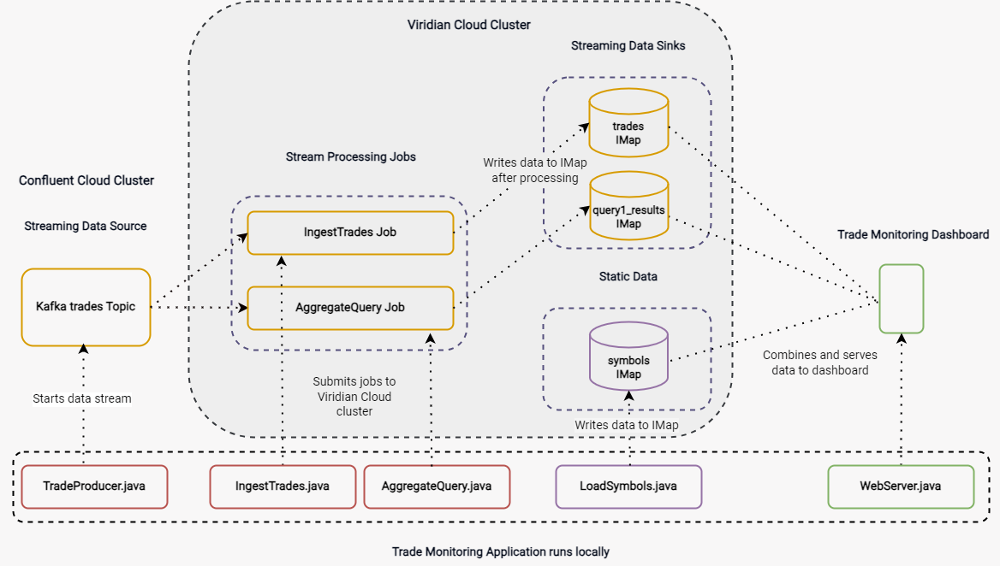
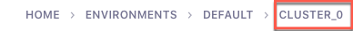
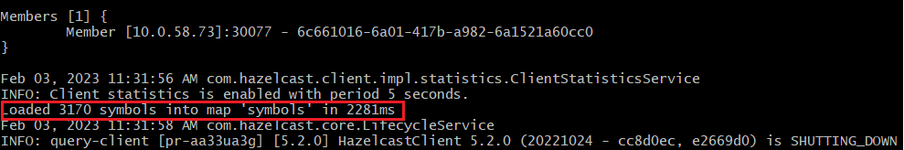
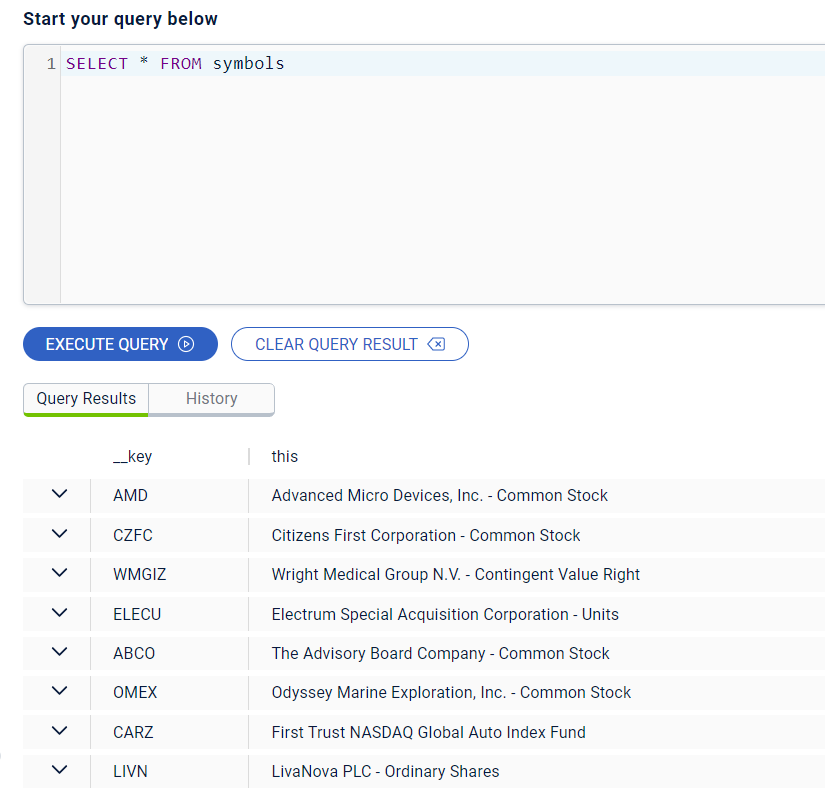
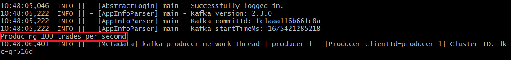
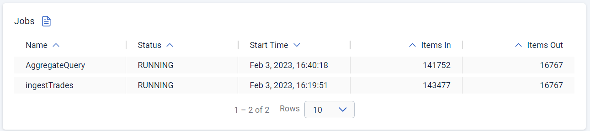
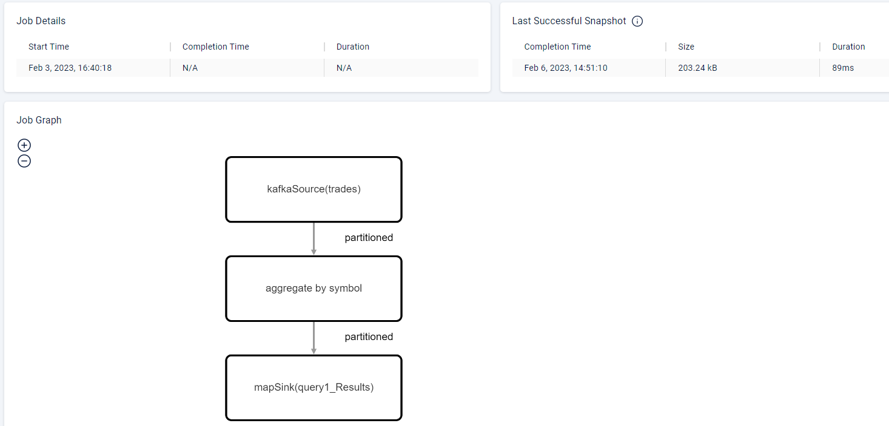
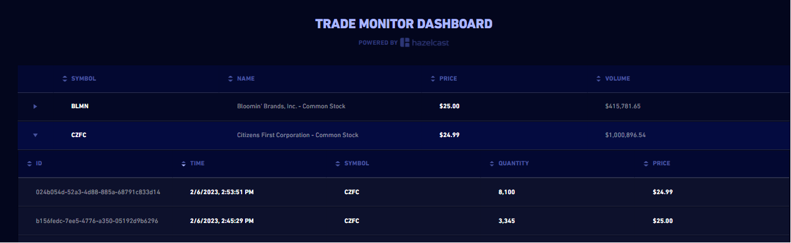

import Tabs from "@theme/Tabs";
import TabItem from "@theme/TabItem";

Deploy a Java application that updates a trade monitoring dashboard in real-time.

## Context

Trading exchanges, platforms, and brokers rely on real-time data.

- Real-time market data allows customers to execute trades in response to the smallest changes in stock prices.
- Real-time trade data allows internal teams to analyze and monitor the trading activities of their customers.

In this tutorial, you'll create a dashboard for monitoring customer's trading activities. You'll learn how a trade monitoring application generates, ingests, aggregates, and enriches streaming data to update the dashboard in real-time.

## Architecture

The trade monitoring application runs locally. Application components create a streaming and static data source, submit stream processing jobs to the <Variable name="hazelcast-cloud" /> cluster, and serve data to the trade monitor dashboard.



Only the streaming data source is hosted on a Confluent Cloud Kafka cluster. All other trades data is hosted and processed on a <Variable name="hazelcast-cloud" /> Standard cluster.

## Components

- [**`TradeProducer.java`**](https://github.com/hazelcast-guides/serverless-trade-monitor-dashboard/blob/master/realtime-trade-monitor/trade-producer/src/main/java/TradeProducer.java): Sets up the streaming data source. This class sends a simulated feed of trades data to a Kafka topic on the Cloud Confluence cluster.
- [**`LoadSymbols.java`**](https://github.com/hazelcast-guides/serverless-trade-monitor-dashboard/blob/master/realtime-trade-monitor/trade-queries/src/main/java/LoadSymbols.java): Creates the `symbols` map on the <Variable name="hazelcast-cloud" /> cluster that contains static stock information, which is used to enrich the streaming data after it is processed.
- [**`IngestTrades.java`**](https://github.com/hazelcast-guides/serverless-trade-monitor-dashboard/blob/master/realtime-trade-monitor/trade-queries/src/main/java/IngestTrades.java): Submits the `ingestTrades` job to the <Variable name="hazelcast-cloud" /> cluster. The `ingestTrades` job creates a data pipeline that processes the stream of trade messages from the Kafka topic and writes them to the `trades` map (streaming data sink).
- [**`AggregateQuery.java`**](https://github.com/hazelcast-guides/serverless-trade-monitor-dashboard/blob/master/realtime-trade-monitor/trade-queries/src/main/java/AggregateQuery.java): Submits the `AggregateQuery` job, which runs in parallel with the `ingestTrades` job on the <Variable name="hazelcast-cloud" /> cluster. The `AggregateQuery` job performs an aggregation on the trades data, grouping trades by stock symbol and keeping a running total of the quantity and values of trades. This data is written to the `query1_Results` map.
- [**`WebServer.java`**](https://github.com/hazelcast-guides/serverless-trade-monitor-dashboard/blob/master/realtime-trade-monitor/webapp/src/main/java/WebServer.java): Combines data from the `trades`, `symbols`, and `query1_Results` map and serves it to the trade monitor dashboard.

## Before you Begin

You need the following:

- A <a href="/cloud/create-serverless-cluster"><Variable name="hazelcast-cloud" /> Standard cluster</a>. You can use either a development or production cluster.
- [Git](https://git-scm.com/book/en/v2/Getting-Started-Installing-Git)
- [Maven](https://maven.apache.org/install.html)
- JDK 17 or later installed and set up as the `JAVA_HOME` environment variable
- A basic understanding of [Kafka](https://hazelcast.com/glossary/kafka/).

## Step 1. Clone the Sample Project {/* #step-one */}

All the code for the trade monitoring application and dashboard is available on Github. To get started, download the code.

<Tabs groupId="https--ssh">
<TabItem value="https" label="HTTPS">

```bash
git clone https://github.com/hazelcast-guides/serverless-trade-monitor-dashboard.git
```

</TabItem>
<TabItem value="ssh" label="SSH">

```bash
git clone git@github.com:hazelcast-guides/serverless-trade-monitor-dashboard.git
```

</TabItem>
</Tabs>

## Step 2. Set Up the Project Files {/* #step-two */}

The sample project uses a Java client to connect to your <Variable name="hazelcast-cloud" /> Standard cluster. To allow this connection, download the TLS certificate files from the cluster and update the client configuration.

1. Sign into the <Variable href="{page-cloud-console}" text="{hazelcast-cloud} console" /> and select your cluster.
2. Next to **Connect Client**, select any client and then select the **Advanced Setup** tab.
3. Download the keystore file. Keep the **Advanced Setup** tab open, you'll need it in later steps.
4. Extract the files and copy both `client.keystore` and `client.truststore` into the following directories of your cloned project:

   - `realtime-trade-monitor/trade-queries/src/main/resources`
   - `realtime-trade-monitor/webapp/src/main/resources`
5. In the same directories, update the `hazelcast-client.yml` files with your cluster connection credentials. You'll find these details on the **Advanced Setup** tab.

   ```yaml
   hazelcast-client:
     cluster-name: <YOUR CLUSTER ID>
     instance-name: query-client
     network:
       ssl:
         enabled: true
         properties:
           protocol: TLSv1.2
           trustStore: <PATH>/serverless-trade-monitor-dashboard/realtime-trade-monitor/<DIRECTORY NAME>/src/main/resources/client.truststore
           trustStorePassword: <YOUR TRUSTSTORE PASSWORD>
           trustStoreType: jks
           keyStore: <PATH>/serverless-trade-monitor-dashboard/realtime-trade-monitor/<DIRECTORY NAME>/src/main/resources/client.keystore
           keyStorePassword: <YOUR KEYSTORE PASSWORD>
           keyStoreType: jks
       hazelcast-cloud:
         discovery-token: <YOUR DISCOVERY TOKEN>
         enabled: true
     properties:
       hazelcast.client.cloud.url: https://api.cloud.hazelcast.com
   ```

   :::note

   If necessary, update the absolute paths to the `client.keystore` and `client.truststore` files to match your directory structure.

   :::

## Step 3. Set Up Your Confluent Cloud Kafka Cluster {/* #step-three */}

To generate a streaming data source for the trade monitor dashboard, you need to create a Kafka topic on a Confluent cluster. The easiest way to do this is to use a free Confluent Cloud cluster.

1. Create a [Confluent Cloud account](https://confluent.cloud/signup) if you don't have one already.
2. Select the same cloud provider as your <Variable name="hazelcast-cloud" /> cluster and the region that's closest to the cluster. For example, AWS Oregon (us-west-2).
3. Skip payment and launch the cluster.
4. Select the name of your cluster in the breadcrumbs at the top of the page.

   

Next, create your Kafka topic.

1. Click **Topics** \> **Create Topic**.
2. Enter **trades** in the **Topic name** box and **4** in the **Partitions** box.
3. Click **Create with defaults**.
4. Click **Clients** and select **Java**.
5. Click **Create Kafka cluster API key**. Enter the **Cluster ID** of your <Variable name="hazelcast-cloud" /> cluster into the **Description** box. This helps you remember which API key this <Variable name="hazelcast-cloud" /> cluster is using.
6. Copy the code from your configuration snippet from the top to `acks=all`. You won't use the Schema Registry in this tutorial.

## Step 4. Add the Connection Details of the Confluent Cloud Cluster {/* #step-four */}

To allow the Java client to access the trades topic, add the connection details of the Confluent Cloud cluster to the client configuration.

1. Paste the connection details that you copied from Confluent Cloud into the following files replacing the placeholder content:

   - `realtime-trade-monitor/trade-queries/src/main/resources/kafka.properties`
   - `realtime-trade-monitor/trade-producer/src/main/resources/kafka.properties`

     For example:

   ```properties
     # Required connection configs for Kafka producer, consumer, and admin
     bootstrap.servers=<YOUR BOOTSTRAP SERVER>
     security.protocol=SASL_SSL
     sasl.jaas.config=org.apache.kafka.common.security.plain.PlainLoginModule
     required username='<YOUR API KEY>'
     password='<YOUR API SECRET>';
     sasl.mechanism=PLAIN

     # Required for correctness in Apache Kafka clients prior to 2.6
     client.dns.lookup=use_all_dns_ips

     # Best practice for higher availability in Apache Kafka clients prior to 3.0
     session.timeout.ms=45000

     # Best practice for Kafka producer to prevent data loss
     acks=all
   ```
2. Remove the following lines from both files:

```properties
  # Best practice for higher availability in Apache Kafka clients prior to 3.0
  session.timeout.ms=45000
```

## Step 5. Build Your Project {/* #step-five */}

1. From the command prompt, change into the `realtime-trade-monitor/` directory.
2. Execute the following command:

   ```bash
   mvn clean package
   ```

## Step 6. Create the Data Sources {/* #step-six */}

In this step, you'll deploy application components to create the static and streaming data sources.

1. Load the static stock information onto your <Variable name="hazelcast-cloud" /> cluster:

   ```bash
   java -jar trade-queries/target/trade-queries-5.0.jar load-symbols
   ```

   <details>
   <summary>Result</summary>

   The Java client connects to your cluster and creates the `symbols` map with 3170 entries, using the code in the `LoadSymbols` class.

   

   </details>

You can check the stock data on your <Variable name="hazelcast-cloud" /> cluster using SQL.

1. Go back to the cluster console.
2. Select **SQL** in the left navigation to open the SQL Browser.
3. Create a SQL connection to the new `symbols` map.

   ```sql
   CREATE MAPPING symbols
   TYPE IMap
   OPTIONS ('keyFormat'='varchar','valueFormat'='varchar');
   ```
4. Use the `SELECT` statement to query all data in the map.

   ```sql
   SELECT * FROM symbols;
   ```

   <details>
   <summary>Result</summary>

   Your query returns the following data:

   

   </details>
5. Close the SQL Browser.

Next, start the Kafka producer. Execute the following command replacing the placeholders:

- $BOOTSTRAP\_SERVER: The address of your Confluent bootstrap server.
- $TRADES\_PER\_SECOND: The number of trades that you want your data source to produce every second, e.g. 100.

  ```bash
  java -jar trade-producer/target/trade-producer-5.0.jar $BOOTSTRAP_SERVER $TRADES_PER_SECOND
  ```

  <details>
  <summary>Result</summary>

  The trades Kafka topic starts to produce a stream of trade messages at the required interval.

  

  </details>

:::note

Keep this terminal window open until you complete the final step of the tutorial.

:::

## Step 7. Process the Streaming Data {/* #step-seven */}

In this step, you'll submit the `IngestTrades` and `AggregateQuery` stream processing jobs to your <Variable name="hazelcast-cloud" /> cluster. You'll also check that both jobs are running.

1. In a new terminal window, change into the `realtime-trade-monitor/` directory.
2. Execute the following command to submit and start the `IngestTrades` job:

   ```bash
   java -jar trade-queries/target/trade-queries-5.0.jar ingest-trades $BOOTSTRAP_SERVER
   ```

   <details>
   <summary>Result</summary>

   The Java client connects to the cluster and quickly disconnects and shuts down. Continue to the next step.

   </details>
3. Submit and start the `AggregateTrades` job:

   ```bash
   java -jar trade-queries/target/trade-queries-5.0.jar aggregate-query $BOOTSTRAP_SERVER
   ```

   <details>
   <summary>Result</summary>

   Again, the Java client connects to the cluster and quickly disconnects and shuts down. Continue to the next step.

   </details>
4. Go back to the cluster console and click **Management Center**.
5. Go to **Streaming** \> **Jobs** to view the status of both jobs.

   

   Both jobs are running. As trade messages are ingested, processed, and written to maps, the total items in and out are updated.
6. Now, select the `AggregateQuery` job to see more details, including the steps in the data pipeline.

   

## Step 8. Launch the Dashboard {/* #step-eight */}

In the final step, you'll launch the trade monitor dashboard.

1. In a new terminal window, change into the `realtime-trade-monitor/` directory.
2. Execute the following command:

   ```bash
   java -jar webapp/target/webapp-5.0.jar
   ```
3. Open a web browser and go to `http://localhost:9000` to launch the dashboard.

   

   For every line in the dashboard, you can see the following details:

   - Stock name from the `symbols` map.
   - Stock price and volume from the aggregated trades data in the `query1_Results` map.

   Expand a row to see the individual trade messages read from the `trades` map.
4. Finally, stop the Kafka producer by pressing <kbd>Ctrl</kbd>+<kbd>C</kbd> to close the connection to the Confluent Cloud cluster.

## Summary

In this tutorial, you learned how to do the following:

- Generate a streaming data source using a Kafka topic.
- Query data in a map from a SQL browser.
- Submit and view stream processing jobs on a <Variable name="hazelcast-cloud" /> cluster.

## Learn More

Use these resources to continue learning:

- [Working with Cluster-Side Modules in Cloud](/cloud/cluster-side-modules).
- [Deploying Cluster-Side Modules to Cloud Clusters](/cloud/custom-classes-upload).
- [Hazelcast Cloud Maven Plugin](/cloud/maven-plugin-hazelcast)
