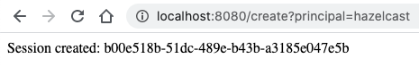
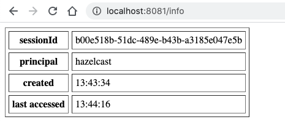
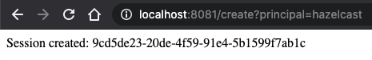
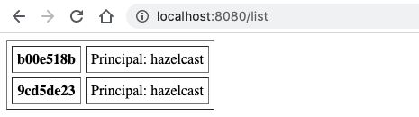

import Tabs from '@theme/Tabs';
import TabItem from '@theme/TabItem';

## What You'll Learn

In this tutorial, you will deploy two Spring Boot applications that use Hazelcast as a HTTP session store and hence share sessions among each other.

Spring Session manages users' session information and supports clustered sessions rather than an application container-specific solution only. That is, more than one application instance can use the same store for user sessions. You can find more details in the [Spring Session Documentation](https://docs.spring.io/spring-session/reference/index.html).

## Before you Begin

- JDK 17+
- Apache Maven 3.9+

## Enable HazelcastHttpSession

Before using Hazelcast session repository, let's add the required dependencies:

```xml title="pom.xml"
<dependency>
    <groupId>com.hazelcast</groupId>
    <artifactId>hazelcast</artifactId>
    <version>${hazelcast.version}</version>
</dependency>
<dependency>
    <groupId>org.springframework.boot</groupId>
    <artifactId>spring-boot-starter-web</artifactId>
</dependency>
<dependency>
    <groupId>com.hazelcast.spring</groupId>
    <artifactId>hazelcast-spring-session</artifactId>
</dependency>
```

Now configure the app to use Hazelcast as HTTP session store:

```java title="SessionConfiguration.java"
@Configuration
@EnableHazelcastHttpSession
class SessionConfiguration {
    // ...
}
```

Alternatively, you may extend `HazelcastHttpSessionConfiguration` to have more advanced configurations rather than using annotation based configuration:

```java
@Configuration
class SessionConfiguration extends HazelcastHttpSessionConfiguration {
    // ...
}
```

## Create a Hazelcast Instance Bean

After enabling Hazelcast HTTP Session, you need to provide a Hazelcast instance to be used by the session repository. This instance can be either a Hazelcast client or an embedded Hazelcast instance. You can see the details of client and embedded modes [here](https://docs.hazelcast.org/docs/latest/manual/html-single/#hazelcast-topology) on the documentation.

<Tabs groupId="client--embedded">
<TabItem value="embedded" label="Embedded">

```java title="SessionConfiguration.java"
    @Bean
    @ConditionalOnExpression("${guide.useClientServer:false} == false")
    public HazelcastInstance hazelcastInstance() {
        Config config = new Config();
        config.getNetworkConfig().getJoin().getTcpIpConfig()
              .setEnabled(true)
              .addMember("127.0.0.1");

        return Hazelcast.newHazelcastInstance(applySerializationConfig(config));
    }
```

</TabItem>
<TabItem value="client" label="Client">

```java title="SessionConfiguration.java"
    @Bean
    @ConditionalOnExpression("${guide.useClientServer:false}")
    public HazelcastInstance hazelcastClient() {
        ClientConfig clientConfig = new ClientConfig();
        clientConfig.getNetworkConfig().addAddress("127.0.0.1:5701");
        return HazelcastClient.newHazelcastClient(applySerializationConfig(clientConfig));
    }
```

:::note

You need to have a running Hazelcast cluster before starting a client. Also, to use all session repository functionalities (e.g. `findByPrincipalName`), Hazelcast members in a cluster must have the map configuration shown in the `Embedded` tab before they start. See the next section for starting a Hazelcast cluster.

:::

</TabItem>
</Tabs>

## Start a Hazelcast Cluster

If you use Hazelcast client, you need to have a running cluster first. You can start Hazelcast members with one of the following methods:

<Tabs groupId="docker-image--download-packages--hazelcast-cli--hazelcast-cloud">
<TabItem value="hazelcast-cloud" label="Hazelcast Cloud">

You can easily create a Hazelcast cluster on [Hazelcast Cloud](https://cloud.hazelcast.com) with just a few clicks. See [Getting Started](https://docs.cloud.hazelcast.com/docs/getting-started) documentation for details.

</TabItem>
<TabItem value="docker-image" label="Docker Image">

You can start members inside Docker containers. See the [documentation](https://docs.hazelcast.com/hazelcast/latest/getting-started/get-started-docker) for details.

```bash
$ docker run hazelcast/hazelcast:$HAZELCAST_VERSION
```

</TabItem>
<TabItem value="hazelcast-cli" label="Hazelcast CLI">

You can start members via Hazelcast CLI. See the [documentation](https://docs.hazelcast.com/hazelcast/latest/getting-started/get-started-cli) for the installation instructions and details.

```bash
$ hz start
```

</TabItem>
<TabItem value="download-packages" label="Download Packages">

You can start members via `start` script. See the [documentation](https://docs.hazelcast.com/hazelcast/latest/getting-started/get-started-binary) for the installation instructions and details.

```bash
$ sh bin/start.sh
```

</TabItem>
</Tabs>

## Using an Existing Instance

Let's say you already have a Hazelcast instance created elsewhere in your application. You can configure Spring Session to use that instance instead of creating a new one:

<Tabs groupId="client--embedded">
<TabItem value="embedded" label="Embedded">

```java
@Bean
@SpringSessionHazelcastInstance
public HazelcastInstance hazelcastInstance() {
    return Hazelcast.getHazelcastInstanceByName("existing-instance-name");
}
```

</TabItem>
<TabItem value="client" label="Client">

```java
@Bean
@SpringSessionHazelcastInstance
public HazelcastInstance hazelcastInstance() {
    return HazelcastClient.getHazelcastClientByName("existing-client-name");
}
```

</TabItem>
</Tabs>

## Customize the Session Repository

Now that you have provided a Hazelcast instance, let's configure the session repository further. Note that these configurations are optional and they will fall back to the defaults when not provided:

<Tabs groupId="annotation--config-extension">
<TabItem value="annotation" label="Annotation">

```java
    @Bean
    public SessionRepositoryCustomizer<HazelcastIndexedSessionRepository> customize() {
        return (sessionRepository) -> {
            sessionRepository.setFlushMode(FlushMode.IMMEDIATE);
            sessionRepository.setSaveMode(SaveMode.ALWAYS);
            sessionRepository.setSessionMapName(SESSIONS_MAP_NAME);
            sessionRepository.setDefaultMaxInactiveInterval(Duration.ofMinutes(2));
        };
    }
```

</TabItem>
<TabItem value="config-extension" label="Config Extension">

```java
@Configuration
class SessionConfiguration extends HazelcastHttpSessionConfiguration {

    SessionConfiguration() {
        setFlushMode(FlushMode.IMMEDIATE);
        setSaveMode(SaveMode.ALWAYS);
        setSessionMapName(SESSIONS_MAP_NAME);
        setMaxInactiveInterval(Duration.ofSeconds(900));
    }

    // ...
}
```

</TabItem>
</Tabs>

## Interactions with User Sessions

Once you completed the configurations, you can reach to the session repository by autowiring it:

```java
@Autowired
FindByIndexNameSessionRepository<?> sessionRepository;
```

Although you do not need to reach this repository explicitly to store or load sessions, some of the methods might be needed such as `findByIndexNameAndIndexValue` or `findByPrincipalName`. Other than these, the following snippet will load and store the sessions for you:

```java
@GetMapping("/check")
public String check(HttpServletRequest request) {
    HttpSession session = request.getSession(false);
    if (session == null) {
        return "No session found.";
    } else {
        session.setAttribute("attr1", 1);
        session.setMaxInactiveInterval(300);
        return "Session found: " + session.getId();
    }
}
```

And we are ready to test Hazelcast session store now!

## Create the Endpoints

To test our session store behavior, create a few endpoints.

In `SessionController.java` you can find 3 of them all of which are `GET` mappings for simplicity:

- `/create`: If there is no session associated with the request, creates a new one with the principal attribute sent as the request parameter.
- `/info`: Gives the session details if the request has a session.
- `/list`: Lists all the sessions with the same principalName of the request's session.

## Start the Applications

Let's now start two application instances to verify that both use the same session store:

```shell
SERVER_PORT=8080 mvn spring-boot:run
SERVER_PORT=8081 mvn spring-boot:run
```

## Test the Applications

- Create a new session on the port 8080:



- See session info on the port 8081:



- Now create another session with the same principal. But be aware that you need to use a different browser or use the private mode of your browser to use separate cookies:



- Let's list all the sessions with the principal `hazelcast`. You can imagine this scenario - for example, finding all the active sessions of a user:



## See Also

You can check other session replication tutorials that serve the same purpose but with different integrations:

- [Session Replication with Spring Boot and Hazelcast](/tutorials/springboot-webfilter-session-replication)
- [Spring Boot Tomcat Session Replication using Hazelcast](/tutorials/springboot-tomcat-session-replication)
