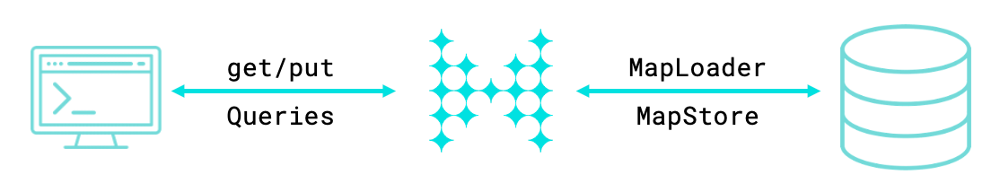
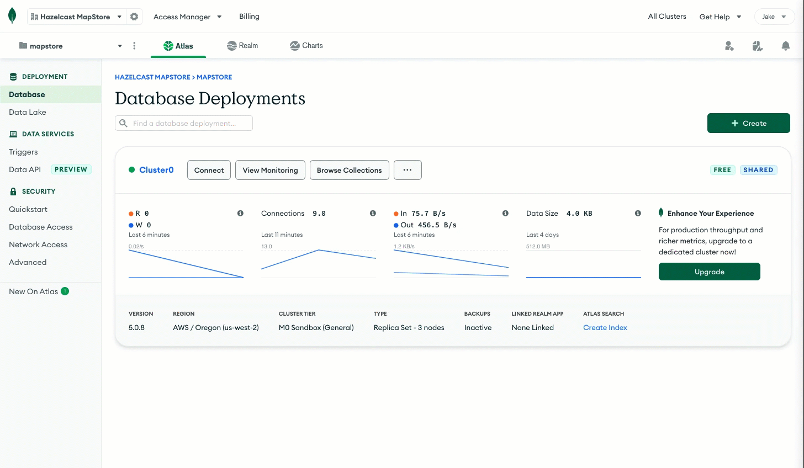
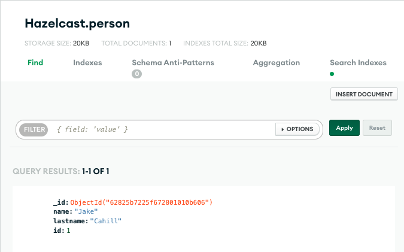

import Tabs from "@theme/Tabs";
import TabItem from "@theme/TabItem";
import CodeBlock from "@theme/CodeBlock";
import Ex_write_through_cache_mongodb_mapstore_src_main_java_sample_com_hz_demos_mapstore_mongo_Person_java_tag_class from "@site/.tutorial-examples/write-through-cache-mongodb-mapstore/src/main/java/sample/com/hz/demos/mapstore/mongo/Person.java?tag=class";
import Ex_write_through_cache_mongodb_mapstore_src_main_java_sample_com_hz_demos_mapstore_mongo_MongoPersonRepository_java_tag_class from "@site/.tutorial-examples/write-through-cache-mongodb-mapstore/src/main/java/sample/com/hz/demos/mapstore/mongo/MongoPersonRepository.java?tag=class";
import Ex_write_through_cache_mongodb_mapstore_src_main_java_sample_com_hz_demos_mapstore_mongo_MongoPersonMapStore_java_tag_class from "@site/.tutorial-examples/write-through-cache-mongodb-mapstore/src/main/java/sample/com/hz/demos/mapstore/mongo/MongoPersonMapStore.java?tag=class";
import Ex_write_through_cache_mongodb_mapstore_pom_xml_tag_maven_plugin_indent_0 from "@site/.tutorial-examples/write-through-cache-mongodb-mapstore/pom.xml?tag=maven-plugin&indent=0";

In this tutorial, you'll build an application that writes changes made to a map back to MongoDB Atlas.

## Context

In a write-through cache, data is updated in both the cache and the data source together. This caching pattern is useful when writes to the cache are infrequent.

To build a write-through cache in Hazelcast, you can use the `MapStore` API. The `MapStore` interface includes methods that are triggered when operations are invoked on a map. You can implement your own logic in these methods to connect to an external data store, load data from it, and write data back to it. For example, you can use a MapStore to load data from a MongoDB, MySQL, or PostgreSQL database.



In this tutorial, you'll deploy the following to a <Variable name="hazelcast-cloud" /> Standard cluster:

- A MapStore that connects to a MongoDB Atlas database and is integrated into the lifecycle of a map.
- A `Person` class that you will store in the cache.

You'll then use SQL to write new `Person` objects to a Hazelcast map, at which point the MapStore will replicate those objects to the MongoDB Atlas database.

:::tip

The code in this tutorial is available as a [sample app on GitHub](https://github.com/hazelcast-guides/write-through-cache-mongodb-mapstore).

:::

## Before you Begin

You'll need the following to complete this tutorial:

- A <a href="/cloud/create-serverless-cluster"><Variable name="hazelcast-cloud" /> Standard cluster</a>.
- [Git](https://git-scm.com/book/en/v2/Getting-Started-Installing-Git)
- [Maven](https://maven.apache.org/install.html)
- JDK 17 or later installed and set up as the `JAVA_HOME` environment variable.

## Step 1. Create a MongoDB Atlas Database {/* #step-one */}

You need a database that your cluster can connect to and store your data in. MongoDB Atlas is a multi-cloud database service that's quick, free, and easy to set up without any payment details.

If you already have a MongoDB database that is accessible to the Internet, you can [skip this step](#step-two). Otherwise, see the following instructions.

1. [Sign up to a MongoDB Atlas account](https://account.mongodb.com/account/register) if you don't have one already.
2. Create an organization and a new project inside that organization.
3. Click **Build a Database** and select the free **Shared** option.
4. Select the **AWS** cloud provider and the region that's closest to the one that you chose when you created your <Variable name="hazelcast-cloud" /> Serverless cluster. The closer the database is to Serverless, the faster the connection.
5. Leave the other options as the defaults and click **Create Cluster**.
6. Enter a username and password for your database and click **Create User**.

   :::tip

   Make a note of these credentials because you will need to give them to <Variable name="hazelcast-cloud" /> Standard later.

   :::

7. Go to **Database** in the left navigation under **Deployment**.
8. Go to the **Collections** tab, click **Add My Own Data**, and create a database called **Hazelcast** with a collection called **person**.

   Your <Variable name="hazelcast-cloud" /> Standard cluster will store your data in this **person** collection.

   

9. Go to **Network Access** in the left navigation under **Security**, and click **Add IP Address**.
10. Select **Allow Access From Anywhere** and click **Confirm**.

Now your database is ready. Your <Variable name="hazelcast-cloud" /> Standard cluster will be able to connect to it and write data to your collection.

## Step 2. Clone the Sample Project {/* #step-two */}

All the code for this project is available on GitHub. In this step, you'll clone the project and learn how it works.

Clone the GitHub repository.

<Tabs groupId="https--ssh">
<TabItem value="https" label="HTTPS">

```bash
git clone https://github.com/hazelcast-guides/write-through-cache-mongodb-mapstore.git

cd write-through-cache-mongodb-mapstore
```

</TabItem>
<TabItem value="ssh" label="SSH">

```bash
git clone git@github.com:hazelcast-guides/write-through-cache-mongodb-mapstore.git

cd write-through-cache-mongodb-mapstore
```

</TabItem>
</Tabs>

The sample code for this tutorial is in the [`src/main/java/sample/com/hz/demos/mapstore/mongo/`](https://github.com/hazelcast-guides/write-through-cache-mongodb-mapstore/tree/master/src/main/java/sample/com/hz/demos/mapstore/mongo) directory:

<details>
<summary>`Person.java`</summary>

This class is for the objects that you will store in a Hazelcast map and that will be replicated to Atlas.

The `Person` class uses the Java `Serializable` interface as a serializer so that Hazelcast can send it to clients and other members as well as deserialize it.

To allow you to query the object fields with SQL, the fields include getters and setters. Although, you can also make the fields public.

<CodeBlock language="java">{Ex_write_through_cache_mongodb_mapstore_src_main_java_sample_com_hz_demos_mapstore_mongo_Person_java_tag_class}</CodeBlock>

[View source](https://github.com/hazelcast-guides/write-through-cache-mongodb-mapstore/tree/master/src/main/java/sample/com/hz/demos/mapstore/mongo/Person.java)

</details>

<details>
<summary>`MongoPersonRepository.java`</summary>

This class declares methods for interacting with the MongoDB database, using the MongoDB Java driver. These methods are invoked by the MapStore, which is defined in the `MongoPersonMapStore.java` file.

<CodeBlock language="java">{Ex_write_through_cache_mongodb_mapstore_src_main_java_sample_com_hz_demos_mapstore_mongo_MongoPersonRepository_java_tag_class}</CodeBlock>

[View source](https://github.com/hazelcast-guides/write-through-cache-mongodb-mapstore/tree/master/src/main/java/sample/com/hz/demos/mapstore/mongo/MongoPersonRepository.java)

</details>

<details>
<summary>`MongoPersonMapStore.java`</summary>

This class declares the trigger methods for the MapStore that will work with a map that has integer keys and `Person` object values.

The class implements the `MapLoaderLifecycleSupport` interface to manage the connection to the database, using the `init()` and `destroy()` methods.

The `init()` method reads the database connection credentials from the Java properties. You'll provide these in the <Variable name="hazelcast-cloud" /> console when you configure the MapStore.

<CodeBlock language="java">{Ex_write_through_cache_mongodb_mapstore_src_main_java_sample_com_hz_demos_mapstore_mongo_MongoPersonMapStore_java_tag_class}</CodeBlock>

[View source](https://github.com/hazelcast-guides/write-through-cache-mongodb-mapstore/tree/master/src/main/java/sample/com/hz/demos/mapstore/mongo/MongoPersonMapStore.java)

</details>

## Step 3. Deploy the Classes to the Cluster {/* #step-three */}

In this step, you'll use the <a href="/cloud/maven-plugin-hazelcast">Hazelcast <Variable name="hazelcast-cloud" /> Maven plugin</a> to package the project into a single JAR file and upload that file to your cluster.

1. Open the `pom.xml` file.
2. Configure the Maven plugin with values for the following elements:

   <table>
<colgroup>
<col style={{width:'50%'}} />
<col style={{width:'50%'}} />
</colgroup>
<thead>
<tr>
<th>Element</th>
<th>Location in the <Variable name="hazelcast-cloud" /> console</th>
</tr>
</thead>
<tbody>
<tr>
<td>`<clusterName>`</td>
<td>Next to **Connect Client**, select any client, and then go to **Advanced Setup**. The cluster name/ID is at the top of the list.</td>
</tr>
<tr>
<td>`<apiKey>` and `<apiSecret>`</td>
<td>

   :::note

   You can create only one API key and secret pair on your account. If you need to change your API credentials, you must first remove your existing credentials, and then create new credentials.

   :::

   To create a set of API credentials, do the following:
   1. Sign into the <Variable href="{page-cloud-console}" text="{hazelcast-cloud} console" />
   2. Select **Account** from the side navigation bar
   3. Select **Developer** from the **Account** options

      The Developer screen displays.

   4. Select the **Generate New API Key** button

   Use these credentials in your applications to manage all clusters in your account.

   After creating your credentials, ensure that you applications are correctly configured to use the API credentials.

   </td>
</tr>
</tbody>
</table>

   <CodeBlock language="xml">{Ex_write_through_cache_mongodb_mapstore_pom_xml_tag_maven_plugin_indent_0}</CodeBlock>

3. Execute the following goal of the Maven plugin to package the project into a JAR file and deploy that file to your <Variable name="hazelcast-cloud" /> Standard cluster:

   ```bash
   mvn clean package hazelcast-cloud:deploy
   ```

You should see that the file was uploaded and is ready to be used.

```none
BUILD SUCCESS
```

## Step 4. Configure the MapStore {/* #step-four */}

To use a MapStore, it must be configured for a specific map in your <Variable name="hazelcast-cloud" /> Standard cluster. When a map is configured with a MapStore, Hazelcast plugs the MapStore implementation into the lifecycle of the map so that the MapStore is triggered when certain map operations are invoked.

1. Open the <Variable name="hazelcast-cloud" /> console.
2. Click **Add +** under **Data Structures** on the cluster dashboard.
3. Click **Add New Configuration** in the top right corner.
4. Enter **person** in the **Map Name** field.
5. In the bottom left corner, select **Enable MapStore**.
6. Select the **sample.com.hazelcast.cloud.mapstore5.mongo.MongoPersonMapStore** classname from the dropdown. If you don't see a classname, you need to <a href="#step-three">deploy the MapStore to your <Variable name="hazelcast-cloud" /> Standard cluster</a>.
7. Leave the **Write Delay Seconds** field set to 0 to configure a write-through cache.

   In this configuration, when you add new entries to the **person** map, Hazelcast will invoke the MapStore's `store()` method before adding the entry to the map.

8. In the **Properties** section, enter the following.

   Hazelcast encrypts these properties to keep them safe.

   <table>
<colgroup>
<col style={{width:'33.3333%'}} />
<col style={{width:'66.6667%'}} />
</colgroup>
<thead>
<tr>
<th>Name</th>
<th>Value</th>
</tr>
</thead>
<tbody>
<tr>
<td>**uri**</td>
<td>Your MongoDB connection string. You can find this connection string in the [Atlas console](https://www.mongodb.com/docs/relational-migrator/database-connections/mongodb/).</td>
</tr>
<tr>
<td>**database**</td>
<td>

   The name of the database that you created in [step 1](#step-one).

   ```none
   Hazelcast
   ```

   </td>
</tr>
</tbody>
</table>

9. Click **Save Configuration**.

## Step 5. Test the MapStore

To test that the MapStore is working, you need to create a map, add some entries to it, and check that those entries are replicated to your MongoDB database.

1. Sign into the <Variable name="hazelcast-cloud" /> console.
2. Click **Management Center**.
3. Click **SQL Browser** in the toolbar at the top of the page.
4. Execute the following queries to set up a connection to the map and add an entry to it.

   ```sql
   CREATE MAPPING person
   TYPE IMap
   OPTIONS (
       'keyFormat' = 'int',
       'valueFormat' = 'java',
       'valueJavaClass' = 'sample.com.hz.demos.mapstore.mongo.Person')
   ```

   ```sql
   INSERT INTO person VALUES (
     1, 1, 'Cahill', 'Jake'
   );
   ```

5. Open your database in MongoDB Atlas and click on the **person** collection.

   You should see that the collection has a new document, which contains the same data as the map entry you added to the map in Serverless.

   

If your test fails, do the following:

1. [Remove the MapStore class](/cloud/custom-classes-upload).
2. Update the MapStore implementation or the configuration and start the process again.

## Summary

In this tutorial, you learned how to do the following:

- Use a Mapstore to write changes made in a <Variable name="hazelcast-cloud" /> Standard cluster back to a MongoDB Atlas database.
- Deploy the MapStore to a <Variable name="hazelcast-cloud" /> Standard cluster, using the Hazelcast <Variable name="hazelcast-cloud" /> Maven plugin.
- Trigger the MapStore by adding data to a map, using SQL.

## Learn More

Use these resources to continue learning:

- [Build a MapStore for Hazelcast Cloud](/cloud/maploader-and-mapstore).
- [Working with Cluster-Side Modules in Cloud](/cloud/cluster-side-modules).
- [Deploying Cluster-Side Modules to Cloud Clusters](/cloud/custom-classes-upload).
- [Hazelcast Cloud Maven Plugin](/cloud/maven-plugin-hazelcast)
- [`MapStore`](https://docs.hazelcast.org/docs/latest/javadoc/com/hazelcast/map/MapStore.html) API reference
